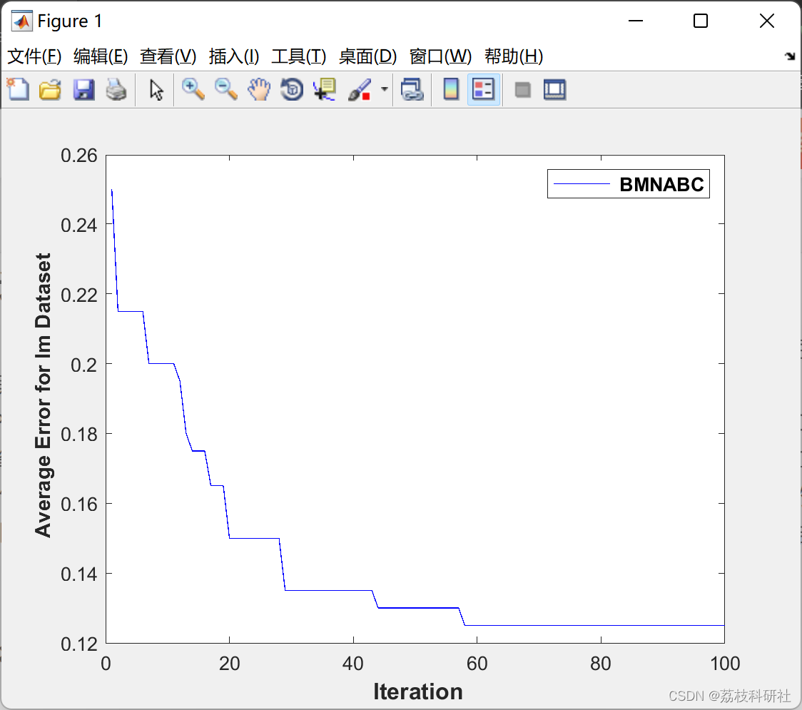

# [Feature Selection] Based on Bi-level Multi-Neighborhood Artificial Bee Colony (BMNABC) Feature Selection Problem (Matlab Code Implementation)

📚2 Running Results Edit
Part of the code:
function [BestChart,Error,BestFitness,BestPosition]= BMNABC(FoodNumber,maxCycle,D,fobj,Limit)  
global SzW  
rand('state',sum(100*clock)) %#ok  
%reset trial counters  
trial=zeros(1,FoodNumber);  
rmin=0;rmax=1;  
Vmax=6;  
BestChart=[];  
%%  
%/FoodNumber:The number of food sources equals the half of the colony size*/  
Foods=initialization(FoodNumber,D,1,0)>0.5;  
for i=1:FoodNumber  
ObjVal(i) =feval(fobj,Foods(i,:));  
end  
BestInd=find(ObjVal==min(ObjVal));  
BestInd=BestInd(end);  
BestFitness=ObjVal(BestInd);  
BestPosition=Foods(BestInd,:);  
x=BestPosition;
Acc=(SzW*sum(x)/length(x)-BestFitness)/(1-SzW)+1; % This relation is computed based on FitnessValue=(1-SzW)*(1-cp.CorrectRate)+SzW*sum(x)/(length(x));  
% The feature subset is based on two criteria: the maximum classi?cation accuracy (minimum error rate) and the minimal number of selected features.  
%Fitness = a* ClassificationError+ (1-a) NumberOfSelectedFeatures/TotalFeatures  
Error=1-Acc;  
BestChart=[BestChart,Error];  
fprintf('Iteration:%3d\tAccuracy:%7.4f\tFitness:%7.4f\t#Selected Features:%d\n',1,((1-Error)*100),BestFitness,(sum(BestPosition,2)));  
gindex=BestInd;  
pbest=Foods;  
pbestval=ObjVal;  
iter=2;  
while ((iter <=maxCycle)),  
r= rmax-iter*(rmax-rmin)/maxCycle;  
%%  
%%%%%%%%% EMPLOYED BEE PHASE %%%%%%%%%%%%%%%%%%%%%%%%%%%%%%%%%%%%%%%%%%  
for i=1:(FoodNumber)  
neigh=[]; d=[]; dd=[];  
w=0;  
for k=1:FoodNumber  
if k~=i  
w=w+1;  
d(w)=sum(Foods(i,:)~=Foods(k,:)); %Hamming distance.  
dd(w)=k;  
end  
end  
Meand=mean(d);  
Maxd=max(d);  
u=1;  
for z=1:w  
if (d(z)<=Maxd && d(z)>=r*Meand)  
neigh(u)=dd(z);  
u=u+1;  
end  
end  
fi=rand(length(neigh),D);  
FIP=sum(fi.*pbest(neigh,:))./sum(length(neigh));  
sol=Foods(i,:);  
V(i,:)=rand(1,D).*(Foods(i,:)-FIP);  
V(i,:)=max(min(V(i,:),Vmax),-Vmax);  
aa=abs(tanh(V(i,:)));  
AA=1-exp(-trial(i)/(iter*maxCycle));  
S=AA+aa;  
temp=rand(1,D)<S;  
moving=find(temp==1);  
sol(moving)=~sol(moving);  
ObjValSol=feval(fobj,sol);  
if (ObjValSol<pbestval(i))  
pbest(i,:)=sol;  
pbestval(i)=ObjValSol;  
end  
if (ObjValSol<ObjVal(i))  
Foods(i,:)=sol;  
ObjVal(i)=ObjValSol;  
trial(i)=0;  
else  
trial(i)=trial(i)+1; %/*if the solution i can not be improved, increase its trial counter*/  
end;  
end;  
%%  
%%%%%%%%%%%%%%%%%%%%%%%% ONLOOKER BEE PHASE %%%%%%%%%%%%%%%%%%%%%%%%%%%  
i=0;  
while(i<FoodNumber)  
i=i+1;  
neigh=[]; d=[];dd=[];  
w=0;  
for k=1:FoodNumber  
if k~=i  
w=w+1;  
d(w)=sum(Foods(i,:)~=Foods(k,:));  
dd(w)=k;  
end  
end  
Meand=mean(d);  
u=1;  
for z=1:w  
if (d(z)<=Meand)  
neigh(u)=dd(z);  
u=u+1;  
end  
end  
[tmp,tmpid]=min(ObjVal(neigh));  
nn=neigh(tmpid);  
sol=Foods(i,:);  
V(i,:)=rand(1,D).*(Foods(i,:)-Foods(nn,:));  
V(i,:)=max(min(V(i,:),Vmax),-Vmax);  
aa=abs(tanh(V(i,:)));  
AA=1-exp(-trial(i)/(iter*maxCycle));  
S=AA+aa;  
temp=rand(1,D)<S;  
moving=find(temp==1);  
sol(moving)=~sol(moving);  
ObjValSol=feval(fobj,sol);  
if (ObjValSol<pbestval(i))  
pbest(i,:)=sol;  
pbestval(i)=ObjValSol;  
end  
% /*a greedy selection is applied between the current solution i and its mutant*/  
if (ObjValSol<ObjVal(i)) %/*If the mutant solution is better than the current solution i, replace the solution with the mutant and reset the trial counter of solution i*/  
Foods(i,:)=sol;  
ObjVal(i)=ObjValSol;  
trial(i)=0;  
else  
trial(i)=trial(i)+1; %/*if the solution i can not be improved, increase its trial counter*/  
end;  
end  
%%  
%/*The best food source is memorized*/  
ind=find(ObjVal==min(ObjVal));  
ind=ind(end);  
if (ObjVal(ind)<BestFitness)  
BestFitness=ObjVal(ind);  
BestPosition=Foods(ind,:);  
x=BestPosition;  
Acc=(SzW*sum(x)/length(x)-BestFitness)/(1-SzW)+1;  
Error=1-Acc;  
gindex=ind;  
success=1;  
else  
success=0;  
end;  
%%  
%%%%%%%%%%%% SCOUT BEE PHASE %%%%%%%%%%%%%%%%%%%%%%%%%%%%%%%%%%%%%%%%%%%%%%%%%%  
%/*determine the food sources whose trial counter exceeds the "Limit" value.  
%In Basic ABC, only one scout is allowed to occur in each cycle*/  
ind=find(trial==max(trial));  
ind=ind(end);  
if (trial(ind)>Limit)  
sol=Foods(ind,:);  
b=randi([1 FoodNumber]);  
while ((b==ind)|| (b==gindex))  
b=randi([1 FoodNumber]);  
end  
if (success==1)  
sol=or(Foods(ind,:),BestPosition) ;  
else  
sol= or (xor(Foods(ind,:),BestPosition) ,or(Foods(ind,:),Foods(b,:)));  
end  
ObjValSol=feval(fobj,sol);  
if (ObjValSol<pbestval(ind))  
pbest(ind,:)=sol;  
pbestval(ind)=ObjValSol;  
end  
if (ObjValSol<ObjVal(ind)) %/*If the mutant solution is better than the current solution i, replace the solution with the mutant and reset the trial counter of solution i*/  
Foods(ind,:)=sol;  
ObjVal(ind)=ObjValSol;  
trial(ind)=0;  
else  
trial(ind)=trial(ind)+1; %/*if the solution i can not be improved, increase its trial counter*/  
end;  
end  
BestChart=[BestChart,Error];  
fprintf('Iteration:%3d\tAccuracy:%7.4f\tFitness:%7.4f\t#Selected Features:%d\n',iter,((1-Error)*100),BestFitness,(sum(BestPosition,2)));  
iter=iter+1;  
end  
🎉3 References  
🌈4 Matlab code implementation

## Images

<!-- PAYMENT_BLOCK -->

## Get this dataset

- Payment link (Stripe): [Buy now](https://buy.stripe.com/3cs8yP7sY87d0vu9AB)
- Payment QR code: 

<!-- /PAYMENT_BLOCK -->
